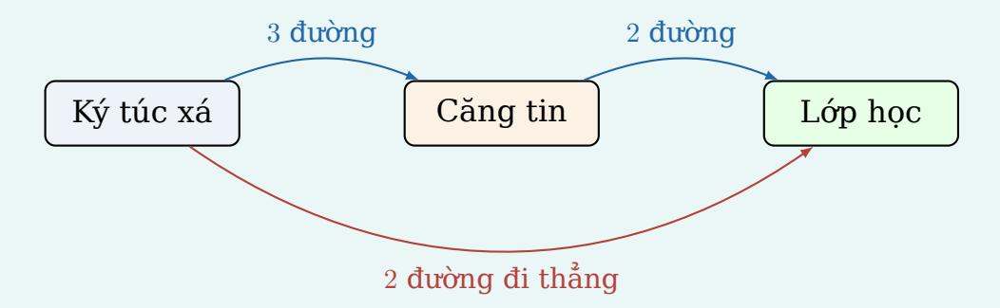

# 20.2 Quy tắc nhân

> Nguồn: Lý_thuyết_Tổ_hợp_Xác_suất_Thống_kê_CD20_CD23 (2).pdf, trang PDF 5, 6, 7. Nội dung máy trích xuất; phải đối chiếu PDF trước khi xuất bản.

## Kiến thức

<!-- source-block:20.2-b-a82d851ecf42 page:5 region:20.2-pdf-1 -->
### 20.2 Quy tắc nhân

<!-- source-block:20.2-b-4458d68e1505 page:5 region:20.2-pdf-1 -->
Nếu để hoàn thành công việc phải thực hiện liên tiếp nhiều bước, số cách bằng tích số lựa chọn ở các bước. Số lựa chọn ở bước sau có thể phụ thuộc vào kết quả bước trước.

<!-- source-block:20.2-b-62aac1733dc9 page:5 region:20.2-pdf-1 -->
Một công việc có thể chia làm k giai đoạn :

<!-- source-block:20.2-b-a9c728f75122 page:5 region:20.2-pdf-1 -->
- Giai đoạn thứ nhất có $n_1$ cách giải quyết,

<!-- source-block:20.2-b-31429e06ceff page:5 region:20.2-pdf-1 -->
- Giai đoạn thứ hai có $n_2$ cách giải quyết,

<!-- source-block:20.2-b-0d3fcaf993a4 page:5 region:20.2-pdf-1 -->
- Giai đoạn thứ k có $n_k$ cách giải quyết,
- Khi đó có $n_1 \times n_2 \times \cdots \times n_k$ cách giải quyết công việc trên.

<!-- source-block:20.2-b-0ae4819b508e page:5 region:20.2-pdf-1 -->
### MẸO NHẬN DẠNG

<!-- source-block:20.2-b-7b216e5c44db page:5 region:20.2-pdf-1 -->
"Hoàn thành bằng phương án này hoặc phương án kia" thường là cộng; "hoàn thành bước 1 và bước 2" thường là nhân.

## Ví dụ có lời giải

<!-- source-block:20.2-b-61fa184541d3 page:5 region:20.2-pdf-1 -->
### VÍ DỤ NHANH

<!-- source-block:20.2-b-a5deb758fb39 page:5 region:20.2-pdf-1 -->
### Quy trình nhắn tin cho ẻm

<!-- source-block:20.2-b-1b8717a32842 page:5 region:20.2-pdf-1 -->
Để soạn một tin nhắn làm quen với ẻm, Đức phải thực hiện ba bước:

<!-- source-block:20.2-b-63d413b528a8 page:5 region:20.2-pdf-1 -->
- Chọn 1 trong 3 câu mở đầu: "Chào em", "Em ăn cơm chưa?" hoặc "Anh đứng đây từ chiều".

<!-- source-block:20.2-b-dec70d7fbcec page:5 region:20.2-pdf-1 -->
- Chọn 1 trong 4 câu tiếp theo để mở câu chuyện: anh học hust, phim mới ra, trời hôm nay đẹp nhỉ hoặc em ăn cơm với gì.

<!-- source-block:20.2-b-541072061224 page:6 region:20.2-pdf-2 -->
- Chọn 1 trong 2 cách kết thúc: "Hehe" hoặc ":))".

<!-- source-block:20.2-b-7ba1d92f87d3 page:6 region:20.2-pdf-2 -->
Theo quy tắc nhân, Đức có thể soạn được:

<!-- source-block:20.2-b-32f36f905167 page:6 region:20.2-pdf-2 -->
$$
N = 3 \cdot 4 \cdot 2 = 24
$$

tin nhắn khác nhau.

<!-- source-block:20.2-b-28cff43959ae page:6 region:20.2-pdf-2 -->
Đức có 24 cách nhắn tin, nhưng em ấy chỉ có đúng một cách trả lời:

<!-- source-block:20.2-b-8efba9a43c56 page:6 region:20.2-pdf-2 -->
Đã xem lúc 22:47

<!-- source-block:20.2-b-8ff803037630 page:6 region:20.2-pdf-2 -->
### VÍ DỤ NHANH

<!-- source-block:20.2-b-8498c66f8f18 page:6 region:20.2-pdf-2 -->
### Số quần áo của Lan

<!-- source-block:20.2-b-b305c63bf543 page:6 region:20.2-pdf-2 -->
Trong tủ quần áo, Lan có:

<!-- source-block:20.2-b-4f223287af5b page:6 region:20.2-pdf-2 -->
- 6 chiếc áo;

<!-- source-block:20.2-b-90406b7ab0fe page:6 region:20.2-pdf-2 -->
- 5 chiếc quần hoặc chân váy;

<!-- source-block:20.2-b-a83650d16e52 page:6 region:20.2-pdf-2 -->
- 4 đôi giày.

<!-- source-block:20.2-b-3d28b097540f page:6 region:20.2-pdf-2 -->
Mỗi bộ trang phục gồm một chiếc áo, một chiếc quần hoặc chân váy và một đôi giày. Theo quy tắc nhân, Lan có thể phối được:

<!-- source-block:20.2-b-0435e98e0cc6 page:6 region:20.2-pdf-2 -->
$$
N = 6 \cdot 5 \cdot 4 = 120
$$

bộ trang phục khác nhau.

<!-- source-block:20.2-b-a6c6d3c1fa5e page:6 region:20.2-pdf-2 -->
Tuy có 120 cách phối đồ nhưng sau khi đứng trước tủ quần áo 2 tiếng, Lan vẫn : Không có gì để mặc cả

<!-- source-block:20.2-b-39198c9b5be2 page:6 region:20.2-pdf-2 -->
### VÍ DỤ NHANH

<!-- source-block:20.2-b-14b4670381c3 page:6 region:20.2-pdf-2 -->
### Đường đến lớp

<!-- source-block:20.2-b-ce7b1407794c page:6 region:20.2-pdf-2 -->
Từ ký túc xá đến lớp học, Nam có hai phương án:

<!-- source-block:20.2-b-f4a8ba006b07 page:6 region:20.2-pdf-2 -->
- Phương án 1: Đi thẳng đến lớp bằng một trong 2 con đường.

<!-- source-block:20.2-b-bbd6924f4e4b page:6 region:20.2-pdf-2 -->
- Phương án 2: Đi qua căng tin. Có 3 đường từ ký túc xá đến căng tin và 2 đường từ căng tin đến lớp.

<!-- source-block:20.2-b-c2b69e3ed0a3 page:6 region:20.2-pdf-2 -->
_[Hình ảnh nguồn tại trang 6]_

<!-- source-block:20.2-b-69a3da6101ba page:6 region:20.2-pdf-2 -->
Nếu Nam đi qua căng tin thì theo quy tắc nhân, số cách đi là:

<!-- source-block:20.2-b-c2a830d65463 page:6 region:20.2-pdf-2 -->
$$
3 \cdot 2 = 6
$$

cách.

<!-- source-block:20.2-b-5a6d1c7fa3e1 page:7 region:20.2-pdf-3 -->
Nam có thể đi thẳng hoặc đi qua căng tin nên theo quy tắc cộng, tổng số cách đến lớp là:

<!-- source-block:20.2-b-cbcd02e36f3d page:7 region:20.2-pdf-3 -->
$$
N = 2 + 3 \cdot 2 = 8 \text{ cách}.
$$

<!-- source-block:20.2-b-2246554bed4d page:7 region:20.2-pdf-3 -->
Dù có nhiều đường nhưng mà Nam thấy trời mưa...
