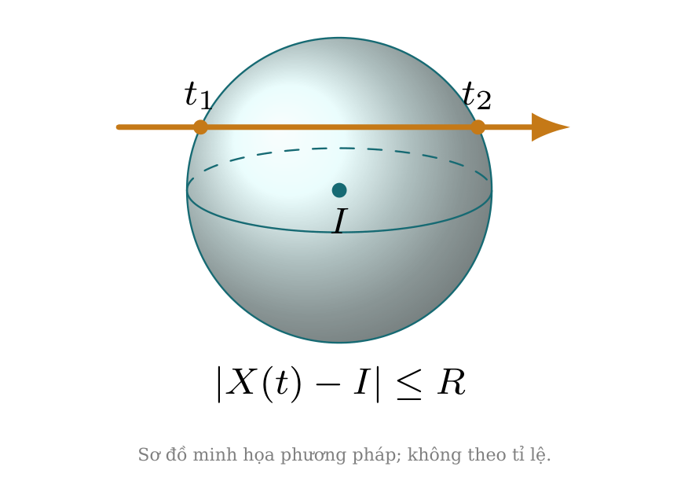

# 33.5 Bài toán radar

> Nguồn: Vecto-Oxyz-CD28-CD33 (1).pdf, trang 34 & 56.

## Kiến thức trọng tâm

Kiến thức và cách làm. Vùng radar là khối cầu: giải bất phương trình khoảng cách không vượt bán kính, rồi giao với khoảng thời gian quan sát.

|X(t) - I| \le R

## Ví dụ có lời giải chi tiết

### Ví dụ 33.5.1
Radar tâm O, bán kính 5 km. Xét mục tiêu A = (3; 4; 0) và B = (3; 4; 1).

**Lời giải từ tài liệu:**
OA = 5 nên A ởbiên được phát hiện nếu vùng đóng; OB = √ 26 > 5 nên B ngoài vùng.

### Ví dụ 33.5.2
Mục tiêu M(t) = (t −6; 3; 0) km, t ≥0 phút. Tìm thời gian trong radar bán kính 5.

**Lời giải từ tài liệu:**
(t −6)2 + 9 ≤25 cho t ∈[2; 10], thời lượng 8 phút.

### Ví dụ 33.5.3
Mục tiêu M(t) = (t; 5; 0) km. Radar bán kính 5 ghi nhận trong khoảng thời gian dài bao nhiêu?

**Lời giải từ tài liệu:**
Chỉtại t = 0 vì t2 + 25 ≤25; thời lượng 0, dù có một thời điểm chạm biên.

### Ví dụ 33.5.4
Radar đặt tại I = (1; 2; 3) km, bán kính 4. Viết ranh giới và toàn vùng phát hiện.

**Lời giải từ tài liệu:**
Ranh giới (x −1)2 + (y −2)2 + (z −3)2 = 16; toàn vùng thay = bằng ≤.

### Ví dụ 33.5.5
Radar ởđộcao 2 km, bán kính 5 km. Bán kính vùng trên mặt đất là bao nhiêu?

**Lời giải từ tài liệu:**
√25 −4 = √ 21 km nếu mặt đất phẳng z = 0.

### Ví dụ 33.5.6
Máy bay chuyển động trên đường cách tâm radar 3 km, tốc độ4 km/phút; bán kính radar 5 km. Thời gian đi qua toàn vùng?

**Lời giải từ tài liệu:**
Dây dài 2√25 −9 = 8 km; thời gian 8/4 = 2 phút.

### Ví dụ 33.5.7
Radar có bán kính 5 km, mục tiêu M(t) = (6 + t; 0; 0), t ≥0. Có lúc nào được phát hiện không?

**Lời giải từ tài liệu:**
Không: OM = 6 + t > 5 và tăng. Đường vô hạn cắt cầu nhưng tia chuyển động không cắt.

### Ví dụ 33.5.8
Một radar ghi tín hiệu đi-vềtrong 20 microgiây. Tính khoảng cách với c = 3 · 108 m/s.

**Lời giải từ tài liệu:**
r = ct/2 = 3000 m = 3 km.

### Ví dụ 33.5.9
Hai radar cùng bán kính 5, tâm cách nhau 6 km. Bán kính đường tròn giao hai mặt biên là bao nhiêu?

**Lời giải từ tài liệu:**
Mặt phẳng giao cách mỗi tâm 3 km, bán kính √25 −9 = 4 km.

### Ví dụ 33.5.10
Radar muốn phủmọi điểm của đoạn từ(2; 0; 0) đến (4; 3; 0), tâm O. Bán kính nhỏnhất?

**Lời giải từ tài liệu:**
Bình phương khoảng cách lồi trên đoạn nên max ởđầu mút. Hai độdài 2 và 5, cần bán kính 5.
